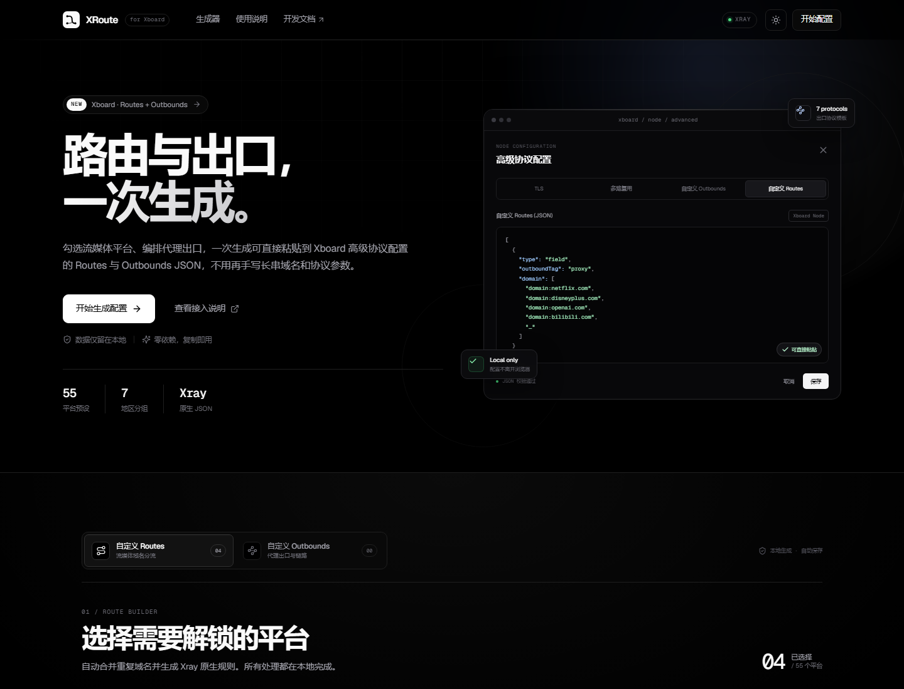

# XRoute

为 **Xboard Node** 高级协议配置中的「自定义 Routes」与「自定义 Outbounds」
生成可直接粘贴的 JSON 配置，支持 **Xray** 与 **sing-box** 双内核。界面参考
Vercel 的极简黑白风格，针对桌面端与移动端做了响应式适配。



## 功能

- 覆盖 55 个流媒体、AI 与地区服务，分为 7 个地区分类
- 在生成器顶部切换 Xray / sing-box 内核
- 默认输出单条 `proxy` 规则，支持按分类配置不同的出口标签
- 支持流媒体分流、全局代理、绕过大陆、全局直连四种流量接管方式
- 支持 7 种出口：SOCKS5、HTTP、Shadowsocks、Trojan、VMess、VLESS、
  WireGuard
- Xray 输出 `field` + `outboundTag` + 嵌套 Outbound settings
- sing-box 输出 `action` + `outbound` + 平铺 Outbound settings
- 预置 Cloudflare WARP 参数，支持链式代理、额外 Settings、标签冲突与循环检测
- 自动合并同标签规则、去重域名并校验 JSON
- 支持显式域名、`domain:`、`full:`、`regexp:` 与 `geosite:` 规则
- 可添加自定义域名、批量选择、搜索与快速预设
- 支持复制、下载和浏览器本地自动保存
- 浅色 / 深色主题

## 先选择内核

生成器选择的内核必须与节点实际运行的 `kernel.type` 一致：

```yaml
kernel:
  type: xray     # 或 singbox
```

如果使用 `instances` 且单独覆盖了 `kernel.type`，以实例级配置为准。

- **Xray**：输出 Xray 原生字段，支持 `geosite` / `geoip`、绕过大陆和广告拦截。
- **sing-box**：输出 sing-box 原生 `action` / `outbound` 与平铺出口字段。
  原生自定义 Routes 不支持 `geosite` / `geoip`，相关选项会自动禁用。

## Routes 生成格式

输出是裸数组，对应 Xboard Node 的 raw `custom_routes`，不需要外层
`routing` 或 `rules` 包装。

### Xray

```json
[
  {
    "type": "field",
    "outboundTag": "proxy",
    "domain": [
      "domain:netflix.com",
      "domain:disneyplus.com"
    ]
  }
]
```

### sing-box

```json
[
  {
    "action": "route",
    "outbound": "proxy",
    "domain_suffix": [
      "netflix.com",
      "disneyplus.com"
    ]
  }
]
```

粘贴到：

```text
Xboard 面板 → 节点编辑 → 高级协议配置 → 自定义 Routes
```

### 流量接管模式

| 模式 | Xray | sing-box | 说明 |
|------|------|----------|------|
| 流媒体分流 | ✅ | ✅ | 只输出所选平台与自定义域名规则 |
| 全局代理 | ✅ | ✅ | 私有网段直连，其余 TCP/UDP 走全局出口 |
| 绕过大陆 | ✅ | ❌ | sing-box 需配置 `rule_set`，UI 会禁用 |
| 全局直连 | ✅ | ✅ | 所选规则优先，其余 TCP/UDP 直连 |

Xray 的全局代理和绕过大陆模式会在规则末尾添加接管所有 TCP/UDP 流量的规则。
绕过大陆模式需要节点包含 `geosite.dat` 与 `geoip.dat`。Xboard Node 的 Xray
内核使用 `domainStrategy: "AsIs"`，因此 `geoip` 规则只匹配目标本身是 IP 的连接。

### 域名格式转换

sing-box 输出会自动转换 Xray 的域名前缀：

| 内部格式 | Xray 字段 | sing-box 字段 |
|----------|-----------|---------------|
| `domain:example.com` | `domain` | `domain_suffix` |
| `full:example.com` | `domain` | `domain` |
| `regexp:^.+example.com$` | `domain` | `domain_regex` |
| `geosite:netflix` | `domain` | 不支持，需 `rule_set` |

自定义域名输入仍支持 URL、`*.domain`、`domain:`、`full:` 与 `regexp:`。

## Outbounds 生成格式

输出为 Xboard 面板可直接接收的结构化裸数组，不要添加外层对象。字段会跟随
生成器选择的内核变化。

### Xray

```json
[
  {
    "tag": "proxy",
    "protocol": "socks",
    "settings": {
      "servers": [
        {
          "address": "1.2.3.4",
          "port": 1080
        }
      ]
    }
  }
]
```

### sing-box

```json
[
  {
    "tag": "proxy",
    "protocol": "shadowsocks",
    "settings": {
      "server": "127.0.0.1",
      "server_port": 21011,
      "method": "aes-128-gcm",
      "password": "<password>"
    }
  }
]
```

粘贴到：

```text
Xboard 面板 → 节点编辑 → 高级协议配置 → 自定义 Outbounds
```

### 链式代理

- Xray 输出根级 `proxy_tag`，由 Xboard Node 转换为 `proxySettings`。
- sing-box 输出 `settings.detour`，这是 sing-box Dial Fields 中的链路字段。
- 生成器会检查重复 tag、自引用、未知引用和生成项之间的循环链。

### 内核能力差异

- Xray 面板只暴露结构化 `tag / protocol / settings / proxy_tag`，无法配置
  Xray 根级 `streamSettings`。需要 TLS、REALITY、WebSocket、gRPC 等能力时，
  应使用节点原生配置。
- sing-box 的 `settings` 会被平铺到 Outbound 顶层，因此可以在「额外 Settings」
  中加入 `tls`、`transport`、`detour` 等 sing-box 原生字段。
- sing-box 原生 raw routes 不能直接写 `geosite` / `geoip`；绕过大陆与广告拦截
  当前只提供 Xray 输出。

### Outbound 标签

`outboundTag` / `outbound` 必须与「自定义 Outbounds」中的 `tag` 一致。仅使用
一个出口时保留默认值 `proxy` 即可。启用「阻止广告」会添加
`geosite:category-ads-all` → `block` 规则；启用「阻止 BT 流量」会添加
`bittorrent` → `block` / `reject` 规则。

### geosite

Xray 默认输出显式域名。只有在节点包含 `geosite.dat` 时，才建议开启
「加入 geosite」。sing-box 模式不会写入该字段，需改用显式域名或 `rule_set`。

## 本地运行

```bash
pnpm install
pnpm dev
```

生产构建与测试：

```bash
pnpm test
pnpm build
pnpm preview
```

构建产物位于 `dist/`，可部署到任意静态站点托管服务。

## 项目结构

```text
src/
  components/       页面组件与交互
  data/services.ts  平台、分类与域名预设
  lib/kernel.ts     内核类型与元数据
  lib/routes.ts     Routes 生成、标签校验、自定义域名解析
  lib/outbounds.ts  Xray / sing-box Outbounds 模板、校验与链式检测
  styles.css        Vercel 风格设计系统与响应式样式
```

平台域名数据维护在 `src/data/services.ts`。新增平台时添加一个 `Service`
对象即可，界面和生成逻辑会自动读取。

## 说明

所有计算都在浏览器本地完成，不会上传节点信息。路由数据仅供技术交流与学习使用，
请遵守当地法律法规以及各平台的服务条款。
